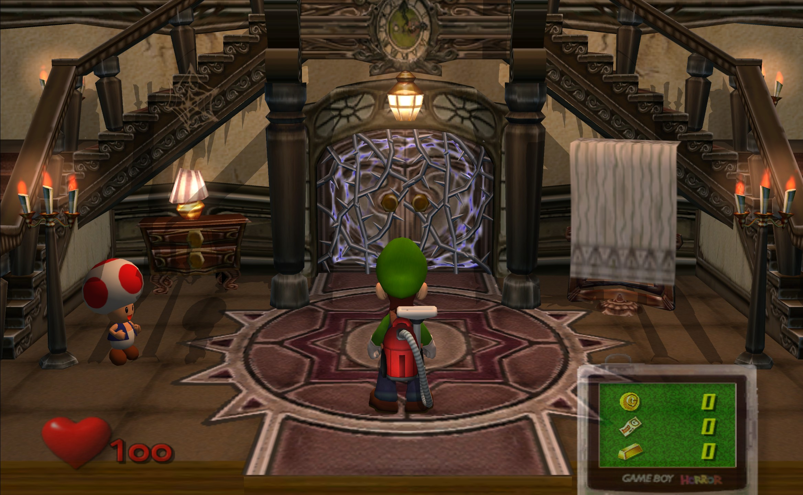
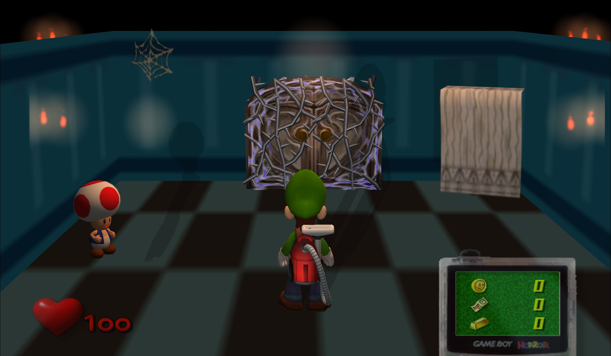
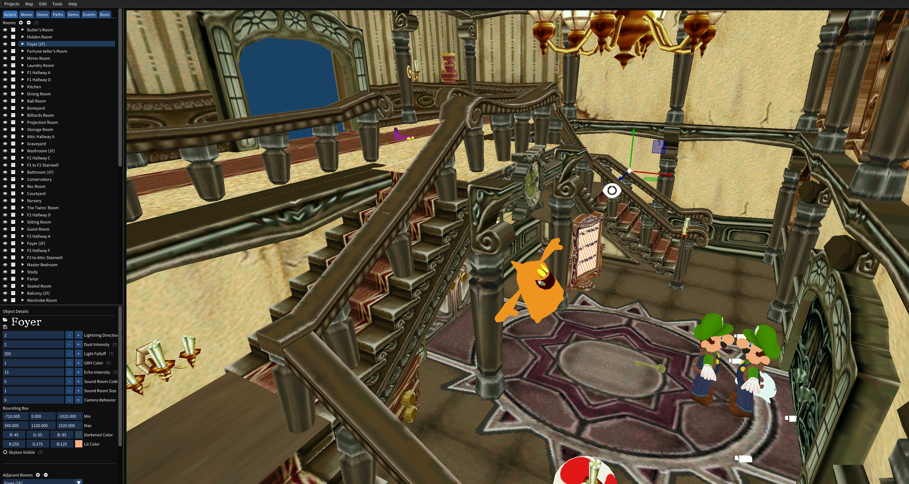
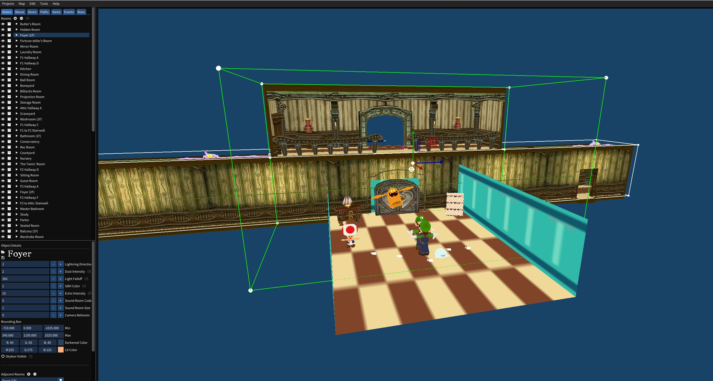

# Luigi’s Mansion Map Editor

Open a Luigi’s Mansion GameCube disc image, browse the mansion, and edit its maps and room models. When you’re ready to see your changes in-game, export a new disc image and launch it in Dolphin from the editor.

## Foyer before and after

The same room shown in Dolphin and in the map editor.

### In-game view

| Original Foyer | Custom Foyer |
| --- | --- |
|  |  |

### Map editor view

| Original Foyer | Custom Foyer |
| --- | --- |
|  |  |

## What you’ll need

- Windows and Visual Studio 2022 with **Desktop development with C++**, CMake, and vcpkg.
- A Luigi’s Mansion disc image from your own copy of the game (`.iso` or `.gcm`).
- Dolphin to test your edits in-game. Blender is optional if you want to make your own room models.

## Build and run

On the [repository page](https://github.com/ewbaer/luigis-mansion-map-editor), choose **Code → Download ZIP**, then extract it. You can also clone it:

```bash
git clone https://github.com/ewbaer/luigis-mansion-map-editor.git
cd luigis-mansion-map-editor
```

1. In Visual Studio, open the cloned folder with **File → Open → Folder**.
2. If your CMake configuration asks for a vcpkg toolchain, point it to `scripts/buildsystems/vcpkg.cmake` inside your vcpkg installation. The project uses vcpkg for ICU and bzip2.
3. Select a **Release** configuration for **x64** and choose **Build → Build All**.
4. Run the executable with the project folder as its working directory so it can find the `res` folder. If your build output is under `out/build/x64-Release`, run this from Git Bash in the project folder:

   ```bash
   ./out/build/x64-Release/LuigisMansionMapEditor.exe
   ```

If you prefer the green play button, open **Debug → Debug and Launch Settings** for the executable and set `"currentDir": "${workspaceRoot}"` in its `launch.vs.json` entry.

## Open a map

1. In the editor, go to **Projects → New**, give the project a name, and select your disc image. The editor extracts a working copy of the game files.
2. Open that project from **Projects**, then choose **Map → Open** and pick the map you want to edit.
3. Select a room in the map view or the room list. Use **Map → Save** after editing map data.

## Replace a room model

1. Select the room and click the archive icon beside its name, or press **Ctrl+Shift+A** to open **Room Resource Files**.
2. Back up the room’s `.arc` file from the extracted project before replacing anything.
3. Expand **Models** and use the minus button beside the current `room.bin`. Use the upload button to import your replacement. The editor accepts native `.bin` files and can convert `.obj` or `.fbx` files on import.
4. Make sure the replacement is named `room.bin` in the archive, then click **Done**. If you see the model in the editor, export a disc and check it in-game too.

## Play your edited map

1. Go to **Edit → Options**, set **Dolphin Path** to your `Dolphin.exe`, and click **Save**.
2. Choose **Map → Export GCM** and save the new `.gcm` outside the extracted project folder.
3. Choose **Tools → Test Disc Image in Dolphin**, select the GCM you just exported, and head to the room you edited.

## License

See [LICENSE](LICENSE).
